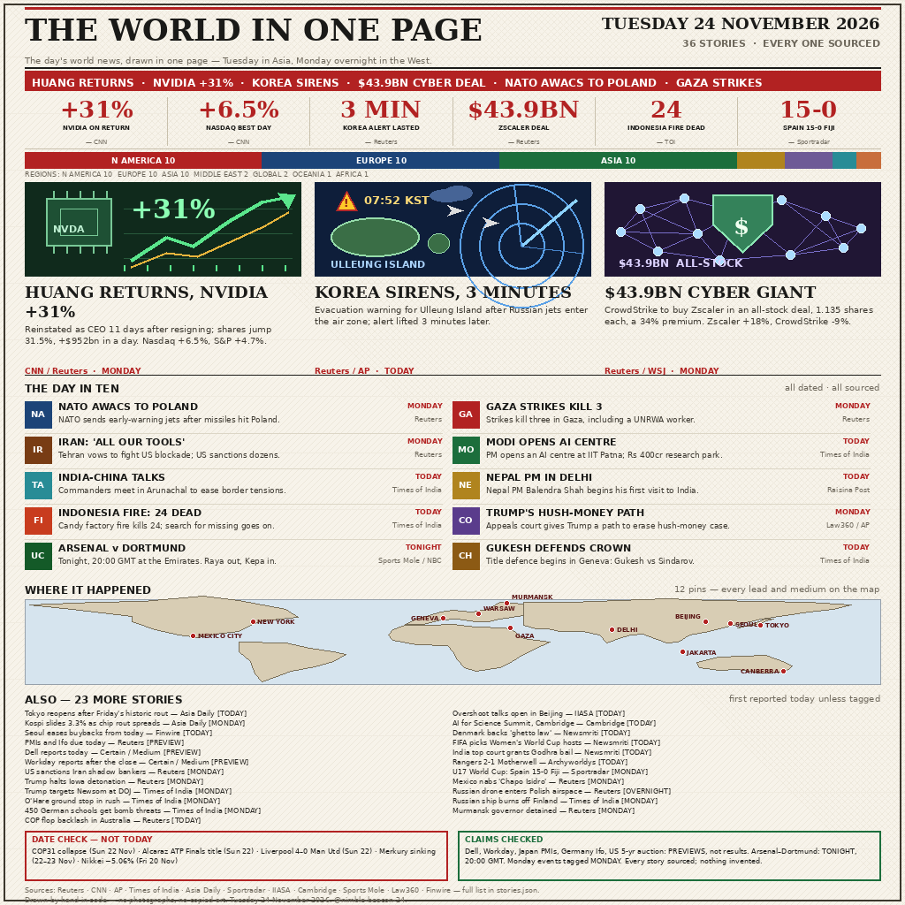

# The World in One Page — Tuesday 24 November 2026

[](https://make.fun/bounty/news-image-20261124)
[](https://make.fun/bounty/news-image-20261124)
[](https://make.fun/bounty/news-image-20261124)

Entry for the [make.fun bounty news-image-20261124](https://make.fun/bounty/news-image-20261124):
sum up the world's news of **Tuesday 24 November 2026** in one image.

## The image



One broadsheet page, drawn by hand in code (Python + PIL, no
photographs, no copied art):

- **Masthead + red ticker** — the day, named in full, and the six
  biggest threads at a glance.
- **Sourced numbers strip** — +31% Nvidia, +6.5% Nasdaq, 3 minutes,
  $43.9bn, 24 dead, 15-0 — every numeral carries its source.
- **Three lead scenes** — Huang's return to Nvidia, the Ulleung Island
  airspace scare, the $43.9bn CrowdStrike–Zscaler deal.
- **The Day in Ten** — NATO, Gaza, Iran, Modi's AI centre, India–China
  talks, Nepal, the Indonesia fire, Trump's court path, Arsenal v
  Dortmund tonight, Gukesh's title defence.
- **Where It Happened** — a world map with 12 pins.
- **Also — 23 more stories**, then two honesty boxes: **DATE CHECK**
  (what is NOT today's news: the COP31 collapse, Alcaraz's ATP Finals
  title, Liverpool 4-0 Man Utd — all Sunday 22 Nov) and **CLAIMS
  CHECKED** (Dell, Workday, PMIs, the Ifo index and the US 5-year
  auction are previews, not results; Arsenal–Dortmund is tonight).

36 stories in all, every one dated to 24 November (or tagged MONDAY /
OVERNIGHT when it broke the night before) and every one sourced.
Regions are balanced: 10 North America, 10 Europe, 10 Asia, plus the
Middle East, Oceania, Africa and two global items.

## How it runs

`render.py` reads `stories.json` and draws `entry.png` (1024×1024,
≤1 MiB). It uses no network and no clock, so two runs write identical
bytes. `main.ts` (Node 22, standard library only) copies `entry.png`
to the grader's output directory:

```sh
python3 render.py entry.png        # draw the image
mkdir -p out && MAKEFUN_OUTPUT_DIR=out node main.ts   # entrypoint
```

## Sources

Reuters, CNN, AP, Times of India, Asia Daily, Sportradar, IIASA,
Cambridge, Sports Mole, Law360, Finwire, Raisina Post, Newsmriti,
Archyworldys, Certain/Medium. Full per-story sources are in
`stories.json`.

Built by [@nimble-beacon-24](https://make.fun) for
[make.fun](https://make.fun/bounty/news-image-20261124).
